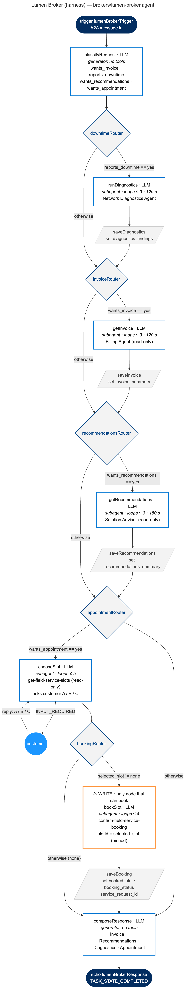

# Lumen Agent Broker — deterministic harness (Agent Network V2)

A MuleSoft Agent Fabric broker that answers Lumen customer requests (invoice, network diagnostics, recommendations, field service booking) with the **business logic in the harness**: a fixed Agent Script graph of routers, executors and narrowly-scoped LLM steps, instead of one LLM prompt that decides everything.

Use this project as the **baseline for future deterministic brokers**. Sections 4–8 are the reusable part: the patterns, the syntax that actually compiles and runs, and the traps found while building it.



Source: [`docs/broker-graph.mmd`](docs/broker-graph.mmd) (Mermaid) · [`docs/broker-graph.svg`](docs/broker-graph.svg)

---

## 0. Configure for your environment

This repo is a template: environment-specific values are placeholders. Replace them before building.

| Placeholder | Where | Replace with |
|---|---|---|
| `<your-org-id>` | `exchange.json` (`organizationId`, `groupId`, `dependencies[].groupId`), `agent-network.yaml` (`ref.namespace`) | Your Anypoint organization ID |
| `https://<billing-agent-url>`, `https://<network-diagnostic-agent-url>`, `https://<solution-advisor-agent-url>` | `exchange.json` → `metadata.variables.*.url` | Your A2A agents (or pass them with `--property` at deploy) |
| `https://<field-service-mcp-server-url>` | `exchange.json` → `fieldServiceMcpServer.url` | Your MCP server base URL (the `/mcp` path is appended from `agent-network.yaml`) |
| `<your-gemini-api-key>` | deploy command only | Your Gemini key. Never commit it; it has no default on purpose |
| `<your-environment>`, `<your-private-space>`, `<your-ingress-gateway>`, `<your-egress-gateway>` | deploy command (§6) | Your Agent Fabric target. Gateways are created once per space with `agent-network setup gateways` |
| `https://<your-ingress-gateway-url>` | README §8, `docs/TEST-PROMPTS.md` | Your ingress gateway's public URL |

The billing, network diagnostics and solution advisor agents must be published to Exchange in your org (they are Exchange dependencies here, see §3.4). If you are starting fresh, define them inline in `registry.agents` instead.

---

## 1. Lineage

| Project | Folder | Shape | Status |
|---|---|---|---|
| V1 agent network (`schemaVersion: 1.0.0`) | `lumen-agent-broker` (V1 project) | One broker, one LLM prompt | Deployed (`lumen-agent-broker`) |
| V2 conversion (`agentNetwork: 2.0.0`) | `lumen-agent-broker_v2_conversion` | One `orchestrator` node, V1 prompt verbatim | Deployed (`/lumen_broker/`) |
| **V2 harness (this project)** | `lumen-agent-broker_v2_harness` (this repo) | 19-node graph, rules in routers | Deployed (`/lumen_broker_harness/`) |

To see exactly what changed from the single-orchestrator version:

```bash
diff -ru -x target -x docs -x README.md \
  <path-to>/lumen-agent-broker_v2_conversion \
  <path-to>/lumen-agent-broker_v2_harness
```

---

## 2. Project layout

```
lumen-agent-broker_v2_harness/
├── agent-network.yaml        # info, registry (inline MCP), context.connections, broker card
├── exchange.json             # asset id, Exchange dependencies, deploy-time variables
├── brokers/
│   └── lumen-broker.agent    # Agent Script graph (dialect AGENTFABRIC=1.0)
├── docs/
│   ├── broker-graph.mmd      # diagram source
│   ├── broker-graph.png
│   └── broker-graph.svg
└── target/                   # build output (generated, not source)
```

---

## 3. Architecture

### 3.1 Request flow

```
trigger → classifyRequest → downtimeRouter ─(downtime)→ runDiagnostics → saveDiagnostics ─┐
                                           └──────────────────────────────────────────────┤
          invoiceRouter ─(invoice)→ getInvoice → saveInvoice ─────────────────────────────┤
                        └─────────────────────────────────────────────────────────────────┤
          recommendationsRouter ─(recommendations)→ getRecommendations → saveRecommendations ┤
                                └─────────────────────────────────────────────────────────┤
          appointmentRouter ─(appointment)→ chooseSlot ⇄ customer → bookingRouter ─(slot)→ bookSlot → saveBooking ─┐
                            └──────────────────────────────────────────┴──────────────────────────────────────────┤
                                                                                   composeResponse → echo
```

A request flows top to bottom through four optional stages (diagnostics, invoice, recommendations, appointment). Every stage is entered only when its router condition is true, and every path ends at the single `echo`.

### 3.2 Nodes

| Node | Type | LLM | Tools it can call | Caps | Output |
|---|---|---|---|---|---|
| `lumenBrokerTrigger` | trigger | — | — | — | starts graph |
| `classifyRequest` | generator | ✓ | none | single call | 4 yes/no flags + customer, location, request_details |
| `downtimeRouter` | router | — | — | — | `reports_downtime == "yes"` |
| `runDiagnostics` | subagent | ✓ | Network Diagnostics Agent | 3 loops, 120 s | `findings` |
| `saveDiagnostics` | executor | — | — | — | `@variables.diagnostics_findings` |
| `invoiceRouter` | router | — | — | — | `wants_invoice == "yes"` |
| `getInvoice` | subagent | ✓ | Billing Agent (read-only) | 3 loops, 120 s | `invoice` |
| `saveInvoice` | executor | — | — | — | `@variables.invoice_summary` |
| `recommendationsRouter` | router | — | — | — | `wants_recommendations == "yes"` |
| `getRecommendations` | subagent | ✓ | Solution Advisor (read-only) | 3 loops, 180 s | `recommendations` |
| `saveRecommendations` | executor | — | — | — | `@variables.recommendations_summary` |
| `appointmentRouter` | router | — | — | — | `wants_appointment == "yes"` |
| `chooseSlot` | subagent + HITL | ✓ | `get-field-service-slots` (read-only) | 5 loops | `selected_slot` ∈ A, B, C, none |
| `bookingRouter` | router | — | — | — | `selected_slot != "none"` |
| `bookSlot` | subagent | ✓ | `confirm-field-service-booking` (**write**) | 4 loops | `booking_status`, `service_request_id` |
| `saveBooking` | executor | — | — | — | booked_slot, booking_status, service_request_id |
| `composeResponse` | generator | ✓ | none | single call | final text |
| `lumenBrokerResponse` | echo | — | — | — | `TASK_STATE_COMPLETED` |

LLM: Gemini `gemini-3.8-flash`, temperature 0.3, top_p 0.95, max_output_tokens 5000, timeout 600 s (V1's settings). The gateway's Gemini provider policy has its own timeout (60 s by default); see the post-deploy patch in §6.

### 3.3 Business rules

**Enforced by the graph — fixed** (routers, pinned arguments and tool scoping; the LLM cannot bypass these):

1. Reported downtime always runs network diagnostics (`downtimeRouter`).
2. The Billing Agent runs only when an invoice is requested (`invoiceRouter`), and the Solution Advisor only when recommendations are requested (`recommendationsRouter`). Each has its own variable, so billing items can't end up in the Recommendations section.
3. Field service slots are offered only for appointment requests (`appointmentRouter`).
4. A booking happens only after the customer picks A, B or C; "none" or anything else skips booking (`bookingRouter`).
5. The booked slot is the one the customer picked: `slotId` is bound from `chooseSlot`'s output, not chosen by the LLM.
6. Least privilege: each LLM step sees only its own tools. Only `bookSlot` can write.
7. Every LLM loop is capped (loops and seconds), so a confused model fails fast instead of looping or double-booking.
8. The reply is built from stored variables only, in a fixed section layout.

**Prompt instructions only — not enforced** (text in a node's instructions; Gemini usually follows them but can deviate, e.g. one run of the combined request on 1.0.8 passed on a question instead of the recommendations, see §7.14):

| Rule | Node |
|---|---|
| What counts as downtime / invoice / recommendations / appointment | `classifyRequest` |
| GRACEFUL FAILURE message when a specialist is slow (V1 wording) | `getInvoice`, `getRecommendations` |
| If an agent fails, errors or asks a question, record "not available" and finish | `runDiagnostics`, `getInvoice`, `getRecommendations` |
| The slot question contains the invoice, diagnostics and every slot | `chooseSlot` |
| Never ask the customer anything | `runDiagnostics`, `getInvoice`, `getRecommendations`, `bookSlot` |
| Exact amounts/times/IDs; never mention tools or agents; never move items between sections | `composeResponse` |

### 3.4 Assets and connections

| Asset | Mode | Version | Connection | Notes |
|---|---|---|---|---|
| `billingAgent` (A2A v0.3) | Exchange dependency | 1.0.0 | `harness_billing_agent_connection` | owned by the V2 conversion project |
| `networkDiagnosticAgent` (A2A v0.3) | Exchange dependency | 1.0.0 | `harness_network_diagnostic_agent_connection` | 〃 |
| `solutionAdvisorAgent` (A2A v0.3) | Exchange dependency | 1.0.0 | `harness_solution_advisor_agent_connection` | 〃 |
| `googleGemini` (LLM) | Exchange dependency | 1.0.0 | `harness_google_gemini_connection` | `apiKey` auth on the connection |
| `fieldServiceMcpServerHarness` (MCP, streamableHttp `/mcp`) | **Inline** registry entry | — | `harness_field_service_mcp_inline_connection` | inline on purpose, see §7 |

The field service MCP server is a mock MCP server. Its booking tool takes a required `slotId` (A/B/C) and returns a different service request ID per slot (`SR-20240314-DAL-0892/0893/0894`).

---

## 4. Design principles (reuse these)

1. **Graph = rules, LLM = judgment.** Anything you can state as a condition goes in a `router`. Use an LLM only where wording must be interpreted or text written.
2. **Classify once, route many.** One `generator` up front turns free text into small enum flags (`"yes"`/`"no"`). Every later decision is a router comparison on those flags.
3. **One domain per LLM step, ≤ 4 tools.** Read-only and write tools never share a step.
4. **Writes are gated and pinned.** The only write step is reachable through a router, and its arguments are bound from earlier outputs (`with slotId = …`), never chosen by the model.
5. **HITL lives in exactly one node.** Only the step that must ask the customer is allowed to; every other LLM step is told never to ask (§7.4).
6. **Shared state via executors.** Optional paths store results in `variables` through small `save*` executors, so the final step works whichever branches ran.
7. **Cap everything.** Set `max_number_of_loops` and `task_timeout_secs` on every subagent/orchestrator. The runtime default is 25 loops.
8. **Single exit.** Every path converges on one `composeResponse` → `echo`.

---

## 5. Building blocks — syntax that compiles and runs

All snippets are taken from `brokers/lumen-broker.agent` (dialect `AGENTFABRIC=1.0`).

**Classifier with enum flags** (use block lists for `enum`, see §7.1):

```text
generator classifyRequest:
  system:
    instructions: |
      ... wants_invoice: "yes" if the customer asks about their invoice ...
  prompt: ->
    | {!@request.payload.message.parts[0].text}
  outputs:
    properties:
      wants_invoice:
        type: "string"
        enum:
          - "yes"
          - "no"
  on_exit: ->
    transition to @router.downtimeRouter
```

**Router** (no `on_exit`; `or` / `and` are supported):

```text
router invoiceRouter:
  routes:
    - target: @subagent.getInvoice
      when: @generator.classifyRequest.output.wants_invoice == "yes"
      label: "Invoice requested"
  otherwise:
    target: @router.recommendationsRouter
```

**Single-tool subagent with structured output and caps:**

```text
subagent runDiagnostics:
  system:
    instructions: |
      1. Call network_diagnostics exactly once ...
      4. Never ask the customer anything or request more input. ...
  reasoning:
    instructions: ->
      | Customer: {!@generator.classifyRequest.output.customer}
    actions:
      network_diagnostics: @actions.network_diagnostic_agent
    outputs:
      properties:
        findings:
          type: "string"
    max_number_of_loops: 3
    task_timeout_secs: 120
  on_exit: ->
    transition to @executor.saveDiagnostics
```

**Save-to-variable executor** (because `on_exit` may only transition):

```text
variables:
  diagnostics_findings: mutable string = ""

executor saveDiagnostics:
  do: ->
    set @variables.diagnostics_findings = @subagent.runDiagnostics.output.findings
  on_exit: ->
    transition to @router.invoiceRouter
```

**Gated write with a pinned argument** (the action declares `inputs:` so `with` is allowed):

```text
actions:
  confirm_field_service_booking:
    target: "mcp://harness_field_service_mcp_inline_connection"
    kind: "mcp:tool"
    tool_name: "confirm-field-service-booking"
    inputs:
      slotId: string

subagent bookSlot:
  reasoning:
    actions:
      book_selected_slot: @actions.confirm_field_service_booking
        with slotId = @subagent.chooseSlot.output.selected_slot
    max_number_of_loops: 4
```

**Human-in-the-loop:** no extra syntax. A `subagent`/`orchestrator` returns `TASK_STATE_INPUT_REQUIRED` when its LLM needs input, and the runtime resumes that same node when the client replies with the same `taskId` + `contextId`. Make the question self-contained: the customer only sees the question text, not earlier tool results.

**Response:**

```text
echo lumenBrokerResponse:
  kind: "a2a:status_update_event"
  state: "TASK_STATE_COMPLETED"
  message: a2a.message({
    messageId: uuid(),
    parts: [ a2a.textPart(@generator.composeResponse.output) ]
  })
```

---

## 6. Build, publish, deploy

**Tooling:** `mulesoft-anypoint-cli-agent-fabric-plugin` 1.4.0 (`npm i -g mulesoft-anypoint-cli-agent-fabric-plugin`), JDK 17.

**Credentials:** the plugin reads only flags or `ANYPOINT_CLIENT_ID`, `ANYPOINT_CLIENT_SECRET`, `ANYPOINT_ORG` env vars. Keep them in a `chmod 600` file and `source` it; never paste secrets into commands.

**Target:** your environment, private space and ingress/egress gateways (see §0).

```bash
cd lumen-agent-broker_v2_harness
export JAVA_HOME=<path-to-jdk-17>
set -a; source <your-anypoint-credentials-file>; set +a

# validate (schema + Agent Script lint)
anypoint-cli-agent-fabric-plugin agent-network project build --path .

# publish this project's own assets (broker + network)
anypoint-cli-agent-fabric-plugin agent-network project publish --path .

# deploy — pass EVERY exchange.json variable, or the CLI waits on a hidden prompt (§7.8)
anypoint-cli-agent-fabric-plugin agent-network project deploy --path . \
  --environment <your-environment> -t <your-private-space> \
  -i <your-ingress-gateway> -e <your-egress-gateway> \
  --property "fieldServiceMcpServer.url:<url>" \
  --property "networkDiagnosticAgent.url:<url>" \
  --property "solutionAdvisorAgent.url:<url>" \
  --property "billingAgent.url:<url>" \
  --property "googleGemini.url:https://generativelanguage.googleapis.com/" \
  --property "googleGemini.modelName:gemini-3.8-flash" \
  --property "googleGemini.apiKey:<your-gemini-api-key>" \
  </dev/null
```

The URL defaults are in `exchange.json` → `metadata.variables`. The Gemini key has no default on purpose.

**Post-deploy patch (re-apply after every deploy).** CLI 1.4.0 can't set these from the project: it builds the Gemini provider policy from the API key only (timeout comes from the policy's schema default, 60 s) and leaves the upstream without LLM metadata (the UI shows "Provider unknown / Model N/A"). Patch the `harness_google_gemini_connection` instance in API Manager:

| Item | Change |
|---|---|
| Upstream | `label: "gemini"`, `metadata.llmConfigs: {provider: "gemini", model: "gemini-3.8-flash", format: "gemini"}` |
| `gemini-llm-provider-policy` | `timeout: 600000` (10 min, V1 parity). Send `apiKey` in the same update; the readback hides it and the update replaces the whole configuration |

Endpoints: `PATCH /apimanager/api/v1/organizations/{org}/environments/{env}/apis/{apiId}/upstreams/{upstreamId}` and `PATCH …/apis/{apiId}/policies/{policyId}` with `{"configurationData": {...}}`. The instance, upstream and policy ids can change on redeploy; look them up first.

**Logs:** Runtime Manager app `lumen-agent-broker-v2-harness`. With CLI v4: `anypoint-cli-v4 runtime-mgr application logs <appId> <specId> --environment <your-environment>`. The `specId` changes on every deploy (`application describe` → `lastSuccessfulVersion`).

---

## 7. Lessons learned (traps that cost a redeploy)

| # | Symptom | Cause | Fix |
|---|---|---|---|
| 7.1 | Request fails in ~4 s: "validation error"; log shows `Input should be a valid list … {'elements': ['yes','no']}` | Inline `enum: ["yes", "no"]` compiles to an object that Gemini's tool schema rejects | Write every `enum` as a block list (`- "yes"`) |
| 7.2 | Build error `on-exit-transition-only` | `on_exit` may contain only `transition to` | Put `set @variables…` in a small executor |
| 7.3 | Build error `'@outputs' is not a recognized namespace` | AgentFabric action definitions have no `outputs:`, so an executor can't read a tool result | Call the tool from a single-action subagent with structured `outputs` |
| 7.4 | Reply is a vague question ("Would you like to proceed…?") with no data | Every subagent/orchestrator has built-in HITL; a non-HITL step used it | Tell every non-HITL step: "Never ask the customer anything; finish by setting your outputs" |
| 7.5 | HITL reply lacks the data ("please review them") | The caller only sees the question text | Instruct the HITL node to put all results and options into the question |
| 7.6 | `TASK_STATE_FAILED … system limit exceeded: reasoning_iterations` | Loop cap too low (2 for call + output) | Allow tool calls + 1 output iteration + 1 spare |
| 7.7 | Publish: "Asset 'billingAgent' belongs to another project" | Inline registry assets are owned by the project that first published them | Reference them as Exchange dependencies (`exchange.json.dependencies` + `ref.namespace`) |
| 7.8 | Deploy hangs forever, nothing in Runtime Manager | CLI prompts for every variable not passed via `--property`, even ones with defaults | Pass all variables; run with `</dev/null` and log to a file |
| 7.9 | Deploy: "Duplicated connection name" | Connection ids must be unique across all networks in an environment | Prefix connections per project (`harness_…`) |
| 7.10 | Graph crash-loops: MCP client … returned HTTP 404 | An MCP server referenced from Exchange resolves by exact version and the `/mcp` transport path isn't applied | Define the MCP server inline (own registry id); the A2A agents and LLM work fine from Exchange |
| 7.11 | Two brokers clash on the gateway | Broker id is the ingress path | Give each broker a unique id (`lumen_broker_harness`) |
| 7.12 | VS Code flags `a2a:status_update_event` / `state` | The IDE extension bundles an older (Beta) schema | Trust the CLI build; it accepts the GA syntax |
| 7.13 | Combined invoice + recommendations request returns a progress note ("…Now I am getting network improvement recommendations."); log: `State update for 'info_summary' failed … parse_json(…).summary` | One orchestrator with two agents ended after the first call and returned plain text instead of its structured output; both results also shared one variable, so the goodwill credit landed under Recommendations | One router + single-tool subagent + variable per service (`getInvoice`, `getRecommendations`) |
| 7.14 | A read-only step asks the customer "Would you like to proceed with just the invoice details?" | When a downstream agent fails or replies with a question, the LLM passes it on through the built-in HITL; there is no setting to disable HITL on a node | Add an explicit fallback to every single-tool step: on failure, error or question, record "not available" and finish |
| 7.15 | Deploy exits 1 with HTTP 502/503 on `PATCH …/apis/<brokerId>` although the graph finished | Transient Anypoint Platform error | Re-run the deploy; it is idempotent |

---

## 8. Test procedure

All prompts used so far, with expected and observed results per version, plus the regression set to run after changes: [`docs/TEST-PROMPTS.md`](docs/TEST-PROMPTS.md).

Endpoint: `https://<your-ingress-gateway-url>/lumen_broker_harness/`

**Turn 1:** send the request, keep `taskId` and `contextId` from the response.

```bash
curl -s -H 'Content-Type: application/json' -H 'A2A-Version: 1.0' "$BROKER" -d '{
  "jsonrpc":"2.0","id":"1","method":"SendMessage",
  "params":{"message":{"messageId":"t1","role":"ROLE_USER","parts":[{"text":
  "Hello I work at Hartwell, can you check my current invoice? Also, we encountered downtime on our network at 2500 Fairmount St, Dallas area. I need a field engineer appointment for a DIA circuit on-site inspection. Only include certified fiber/DIA technicians.",
  "mediaType":"text/plain"}]}}}'
```

Expect `TASK_STATE_INPUT_REQUIRED` with the invoice, diagnostics and slots A/B/C in one message.

Sample turn 1 response (graph 1.0.6, 2026-10-14, abridged to the fields a client reads):

```json
{
  "jsonrpc": "2.0",
  "id": "1",
  "result": {
    "task": {
      "id": "a1033dd1-e070-4163-8ea9-271838ceaf3a",
      "contextId": "eb49798f-1163-4dd7-9a50-616b72f989e1",
      "status": {
        "state": "TASK_STATE_INPUT_REQUIRED",
        "timestamp": "2026-10-14T02:07:30.896041Z",
        "message": {
          "role": "ROLE_AGENT",
          "parts": [{ "text": "Your current invoice for Hartwell is $18400 USD, ... Which slot would you like to book?" }]
        }
      }
    }
  }
}
```

Full message text:

> Your current invoice for Hartwell is $18400 USD, which is $4200 USD higher than your typical total of $14200 USD. This difference is due to $2800 in bandwidth bursting charges for SD-WAN circuits in late February and $1400 in pro-rated charges for an SD-WAN circuit upgrade mid-cycle. You are eligible for a $500 goodwill credit as a 6-year customer. Regarding the network downtime at 2500 Fairmount St, Dallas area, our diagnostics confirm a degraded DIA circuit due to a fiber node fault on a regional segment. An on-site inspection by a certified fiber/DIA field engineer is required and is being arranged for this location. We will ensure only certified fiber/DIA technicians are dispatched. Available slots for tomorrow in Dallas are: A: 9:00 AM - 11:00 AM CT, B: 11:00 AM - 1:00 PM CT, C: 1:00 PM - 3:00 PM CT. Which slot would you like to book?

**Turn 2:** reply on the same task.

```bash
curl ... -d '{"jsonrpc":"2.0","id":"2","method":"SendMessage","params":{"message":{
  "messageId":"t2","role":"ROLE_USER","taskId":"<taskId>","contextId":"<contextId>",
  "parts":[{"text":"B","mediaType":"text/plain"}]}}}'
```

Expect `TASK_STATE_COMPLETED`, sections Invoice / Network diagnostics / Field service appointment, and `SR-20240314-DAL-0893` (slot B).

Sample turn 2 response (same task, reply `B`, 2026-10-14T02:11:34Z). The envelope is the same as turn 1, with `"state": "TASK_STATE_COMPLETED"` and this message text:

```text
Invoice:
* Your current invoice for Hartwell is $18400 USD, which is $4200 USD higher than your typical total of $14200 USD.
* This difference is due to $2800 in bandwidth bursting charges for SD-WAN circuits in late February and $1400 in pro-rated charges for an SD-WAN circuit upgrade mid-cycle.
* You are eligible for a $500 goodwill credit as a 6-year customer.

Network diagnostics:
* Downtime at 2500 Fairmount St, Dallas area.
* Diagnostics confirm a degraded DIA circuit due to a fiber node fault on a regional segment.
* Failover Status: failed.

Field service appointment:
* An on-site inspection for your DIA circuit at 2500 Fairmount St, Dallas area, has been booked for tomorrow, 11:00 AM - 1:00 PM CT.
* Only certified fiber/DIA technicians will be dispatched.
* Service Request ID: SR-20240314-DAL-0893.
```

The figures come from the mock agents and the mock MCP server, so they are the same on every run. The wording around them varies between runs.

**Results on graph version 1.0.6 (2026-10-13):**

| Check | Result |
|---|---|
| Turn 1, 5 runs | 5/5 paused for slot choice with diagnostics and all 3 slots; 4/5 included the invoice (run 4 returned the GRACEFUL FAILURE line instead) |
| Turn 2, reply "B" | Completed; booked slot B, 11:00 AM–1:00 PM CT, `SR-20240314-DAL-0893` |

**Results on graph version 1.0.9 (2026-10-14), after splitting invoice and recommendations:**

| Request | Runs | Result |
|---|---|---|
| "…can you check my current invoice?" | 3 on 1.0.7, 3 on 1.0.8, 1 on 1.0.9 | 7/7 completed with only an Invoice section; goodwill credit inside it |
| "…check my current invoice and recommend improvements to our network?" | 4 on 1.0.9 | 4/4 completed with Invoice + Recommendations (real Solution Advisor output); credit under Invoice |
| Full prompt (turn 1) | 2 on 1.0.8 | 2/2 paused for slot choice with invoice and all 3 slots |
| Full prompt + reply "B" (two turns) | 1 on 1.0.9 | Turn 1 paused with invoice, diagnostics and slots; turn 2 completed, booked slot B, `SR-20240314-DAL-0893`, credit under Invoice |

Re-run turn 1 several times after any prompt change; LLM steps are still non-deterministic in wording.

---

## 9. Template: starting a new deterministic broker from this one

1. **Copy** this folder (without `target/`) and rename `exchange.json` `name`/`assetId`, the broker id under `brokers:`, the trigger target `brokers://<id>/a2a`, and every connection id (unique per environment, §7.9).
2. **List the business rules** in plain language. Mark each one *hard* (must always hold) or *judgment* (needs interpretation).
3. **Design the classifier:** one enum flag per hard decision, plus the entities later steps need.
4. **Draw the graph:** one router per hard rule, one LLM step per domain, writes behind a router with pinned arguments, one HITL node at most, `save*` executors for optional paths, a single compose → echo.
5. **Register assets:** reuse published agents/LLMs as Exchange dependencies; define MCP servers inline (§7.10). Put URLs and secrets in `exchange.json` variables (`secret: true` for keys, no default).
6. **Write prompts** as numbered steps that end in setting outputs; add the never-ask rule to every non-HITL LLM step; use enum literals exactly.
7. **Set caps** on every subagent/orchestrator (tool calls + 2 loops; timeouts for slow agents).
8. **Build → publish → deploy** (§6), then run the two-turn test (§8) at least 5 times.
9. **Update the diagram** (`docs/broker-graph.mmd`) and re-render:
   `npx -y @mermaid-js/mermaid-cli@11 -i docs/broker-graph.mmd -o docs/broker-graph.png -s 2 -b white`

---

## 10. Open items

- **Classifier is still an LLM.** Mis-classifying "downtime" would skip diagnostics. Next step: a keyword router in front of `classifyRequest` for unambiguous terms.
- **GRACEFUL FAILURE wording** ("logistics team") doesn't fit a billing timeout, and nothing follows up later.
- **Only the first message part is read** (`parts[0].text`); multi-part messages lose the rest.
- **Broker allows anonymous callers** (no `authorization` on `brokers.lumen_broker_harness.interfaces.a2a`).
- **A2A agents are v0.3**; move them to the `a2a` interface branch when their owners upgrade to v1.0.
- **Upgrade check:** confirm the latest Agent Fabric CLI and runtime versions before reusing this baseline.
